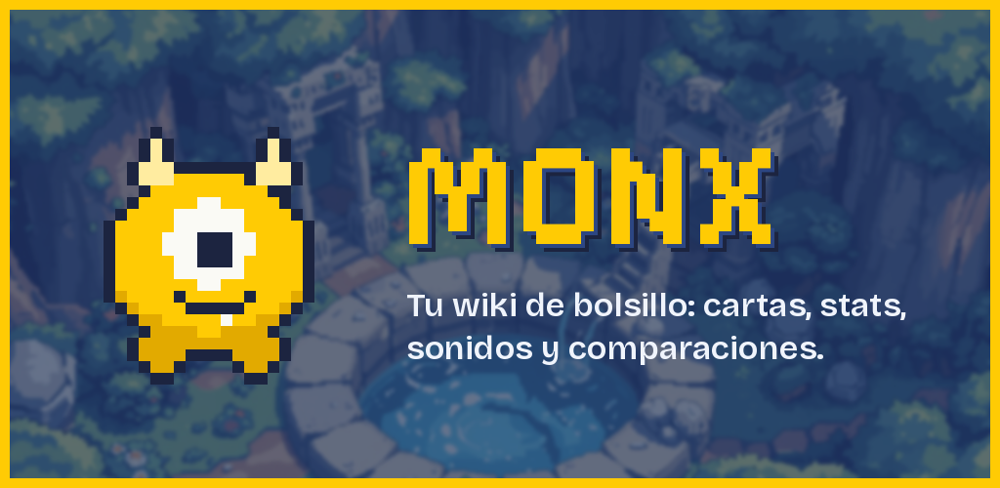

<p align="center">
  
</p>

<h1 align="center">Monx · wiki de bolsillo</h1>

<p align="center">
  Aplicación móvil educativa que consume <a href="https://pokeapi.co/">PokéAPI</a> y muestra cada Pokémon como una <strong>carta</strong>.<br/>
  Ionic 8 · Angular 20 (componentes standalone) · Capacitor 7 · Android
</p>

<p align="center"></p>

> Deber **Investigación y publicación de una Pokédex** — Desarrollo de Aplicaciones Móviles, ESFOT · EPN.
> Basado en el repositorio de referencia [jzaldumbide/pokedex-2026b](https://github.com/jzaldumbide/pokedex-2026b) y en el diseño de [PokeWiki](https://github.com/chico20200/pokewiki).

**Integrantes:** _Nombre Apellido_ · _Nombre Apellido_
**Canal de distribución:** Uptodown (envío a tienda) + APK firmado en GitHub Releases (distribución directa).
**Enlace público en Uptodown:** _pendiente / pegar aquí cuando esté aprobado_

---

## 📱 Funcionalidades

| Nivel | Funcionalidad | Dónde |
|---|---|---|
| 1 · Consulta | Listado de los 1025 Pokémon en mini-cartas con scroll infinito | `pages/explore` |
| 1 · Consulta | Búsqueda por nombre (parcial, sin importar tildes) o por número; botón aleatorio | `pages/explore` |
| 1 · Detalle | Carta completa: imagen, ID, categoría, altura, peso, experiencia, tipos, habilidades (incluida la oculta), estadísticas en barras y descripción en español | `pages/detail` + `components/poke-card` |
| 2 · Multimedia | Sonido (grito) del Pokémon, versión shiny, galería de hasta 8 imágenes, imagen ampliada y animaciones GIF | `pages/detail` |
| 3 · Comparación | Dos cartas enfrentadas, barras en espejo de altura, peso y las 6 estadísticas, ganador resaltado y resumen | `pages/compare` |
| Extra | Historial de consultas guardado en el dispositivo (evolución del `storage.js` de PokeWiki) | `pages/recents` |

Todos los casos sin recurso (sin sonido, sin animación, nombre inexistente, sin internet) muestran un mensaje en vez de fallar.

## 🎨 Diseño

El estilo viene de **PokeWiki** (proyecto web propio en HTML/CSS/JS) y se llevó a componentes de Angular:

- Paleta: azul `#3a5ca6`, amarillo `#ffcb04`, carta `#eeeeed`, texto `#333` → `src/theme/variables.scss`.
- Tipografías *Pixelify Sans* y *Bricolage Grotesque*, incluidas localmente con `@fontsource` para que funcionen sin internet.
- La **tarjeta** (borde azul, franja con #ID, nombre e íconos de tipo, ventana circular, columnas de datos y caja de stats con sombra dura) es un componente standalone reutilizable: `app-poke-card` (grande) y `app-mini-card` (listado y comparación).
- Fondo pixel art de PokeWiki, ícono y pantalla de inicio **originales** de Monx (un monstruo pixel de un solo ojo).

## 🛠️ Tecnologías

| Tecnología | Uso |
|---|---|
| Ionic 8 | Componentes móviles (tabs, toolbar, infinite scroll, modal, toast) |
| Angular 20 standalone | Sin `AppModule`; rutas con `loadComponent` (carga diferida); signals |
| Angular HttpClient + RxJS | Consumo REST con caché (`shareReplay`) y reintento |
| Capacitor 7 | Proyecto nativo Android, Splash Screen y Status Bar |
| PokéAPI | Datos, imágenes, sonidos y animaciones |

## 🗂️ Estructura

```
src/app/
├── app.routes.ts              # tabs/explorar · tabs/comparar · tabs/recientes · pokemon/:id
├── app.info.ts                # nombre, versión e identificador visibles en la app
├── models/pokemon.model.ts    # interfaces de PokéAPI
├── services/
│   ├── pokemon.service.ts     # peticiones + caché + galería, sonido, animaciones
│   └── history.service.ts     # historial en localStorage
├── utils/pokemon-format.ts    # tipos en español, íconos, colores, formatos
├── components/
│   ├── poke-card/             # carta completa (diseño PokeWiki)
│   ├── mini-card/             # carta pequeña
│   ├── stat-bars/             # barras de estadísticas
│   └── type-icons/            # íconos / chips de tipo
└── pages/
    ├── tabs/  explore/  detail/  compare/  recents/
assets/                        # fuentes del ícono y splash (para @capacitor/assets)
android/                       # proyecto nativo (ícono, splash, versión y firma ya configurados)
store/                         # material para la ficha de Uptodown
```

## 📋 Requisitos

- **Node.js 20.19+ o 22.12+** (requisito de Angular 20) y npm.
- **Android Studio** (Ladybug 2024.2 o superior) con Android SDK y **JDK 21** (incluido en Android Studio).
- Un teléfono Android con **depuración USB** activada.

## 🚀 Instalación y ejecución en el navegador

```bash
git clone https://github.com/<usuario>/monx.git
cd monx
npm install
npm start            # http://localhost:8100
```

## 📲 Ejecutar en un teléfono Android

```bash
npm run build                # compila Angular → www/browser
npx cap sync android         # copia la web al proyecto Android
npx cap open android         # abre Android Studio
```

En Android Studio conecta el teléfono, selecciónalo y pulsa **Run ▶**.
Cada vez que cambies código web repite `npm run build` + `npx cap sync android` (si no, el teléfono seguirá con la versión anterior).

> La carpeta `android/` ya está en el repositorio: **no** ejecutes `npx cap add android`.

## 🏷️ Personalización ya aplicada

| Elemento | Valor | Archivo |
|---|---|---|
| Nombre | `Monx` | `capacitor.config.ts`, `android/app/src/main/res/values/strings.xml` |
| Identificador | `io.github.chico20200.monx` | `capacitor.config.ts`, `android/app/build.gradle` |
| Versión | `versionCode 1` · `versionName "1.0.0"` | `android/app/build.gradle` (+ `src/app/app.info.ts`) |
| Ícono y splash | Generados desde `assets/` | `android/app/src/main/res/mipmap-*` y `drawable-*` |

Para regenerar ícono y splash después de editar `assets/*.png`:

```bash
npm run assets
```

**Nueva versión:** sube `versionCode` en 1 (2, 3, …) y cambia `versionName` (1.0.1, …) en `android/app/build.gradle` y en `src/app/app.info.ts`. Uptodown y cualquier tienda rechazan un archivo con el mismo `versionCode` que uno ya publicado.

## 🔐 Generar el APK firmado

### 1. Crear el keystore (una sola vez)

```bash
cd android
keytool -genkeypair -v -keystore monx-release.jks -keyalg RSA -keysize 2048 -validity 10000 -alias monx
```

(`keytool` viene con el JDK de Android Studio: `<Android Studio>/jbr/bin/keytool`).

### 2. Configurar las contraseñas

Copia `android/keystore.properties.example` como `android/keystore.properties` y rellena tus datos.

> ⚠️ `*.jks` y `keystore.properties` están en `.gitignore`. **Nunca los subas a GitHub.** Si pierdes el keystore no podrás publicar actualizaciones de Monx en Uptodown con la misma firma: guarda una copia segura (la pareja debe acordar quién la custodia).

### 3. Compilar

**Opción A — Android Studio:** *Build → Generate Signed App Bundle / APK → APK →* selecciona `monx-release.jks` → variante **release**.

**Opción B — terminal:**

```bash
npm run build && npx cap sync android
cd android
./gradlew assembleRelease      # Windows: gradlew.bat assembleRelease
```

Resultado: `android/app/build/outputs/apk/release/app-release.apk`

Para un **AAB** (solo necesario para Google Play): `./gradlew bundleRelease` → `android/app/build/outputs/bundle/release/app-release.aab`.

### 4. Verificar la firma

```bash
<Android SDK>/build-tools/<versión>/apksigner verify --print-certs android/app/build/outputs/apk/release/app-release.apk
```

Debe mostrar el certificado con el nombre que pusiste al crear el keystore (no "Android Debug").

## 🏪 Publicación

| Canal | Tipo | Estado |
|---|---|---|
| **Uptodown** (Developers Console) | Tienda con revisión manual | _Enviado el dd/mm/aaaa — En revisión / Publicado / Rechazado_ |
| **GitHub Releases** | Distribución directa del APK (no es una tienda ni implica aprobación) | _v1.0.0_ |

Material de la ficha de Uptodown en [`store/`](store/): ícono 512×512, imagen destacada **1024×500**, capturas y textos en [`store/LISTING.md`](store/LISTING.md).
Política de privacidad: [`PRIVACY.md`](PRIVACY.md).

## 🧪 Evidencias de prueba

| Prueba | Dispositivo | Resultado |
|---|---|---|
| Listado, búsqueda y detalle | _Modelo · Android XX_ | ✅ |
| Sonido, galería, imagen ampliada y animación | _Modelo · Android XX_ | ✅ |
| Comparación (2 parejas) | _Modelo · Android XX_ | ✅ |
| Instalación del APK firmado | _Modelo · Android XX_ | ✅ |

_Video de demostración: enlace_

## ⚖️ Aviso legal

Monx es un proyecto educativo, **no oficial** y sin fines de lucro. No está afiliado, patrocinado ni aprobado por Nintendo, Game Freak, Creatures Inc. ni The Pokémon Company. Pokémon y los nombres de sus personajes son marcas registradas de sus respectivos titulares. Los datos, imágenes y sonidos se obtienen en tiempo de ejecución desde [PokéAPI](https://pokeapi.co/), un servicio gratuito e independiente; la app no los redistribuye dentro del APK.

El ícono, la pantalla de inicio y el nombre **Monx** son creaciones originales del proyecto.
# monx
